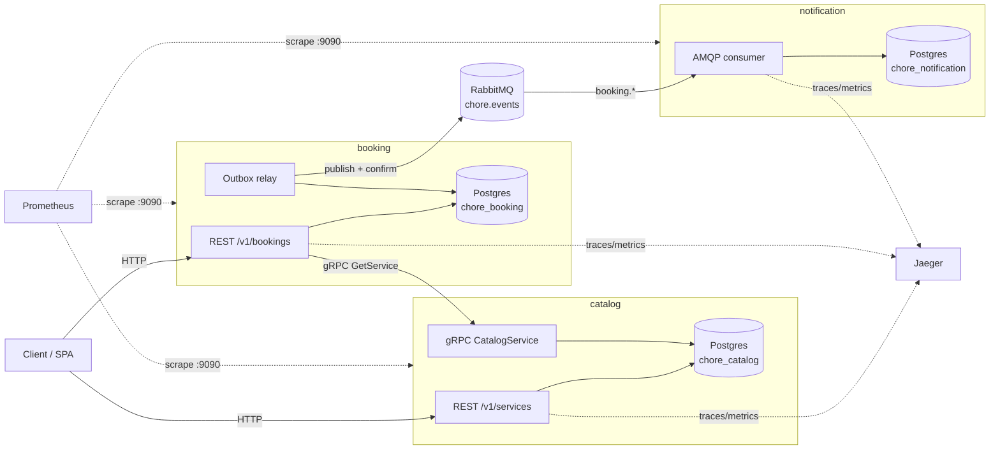
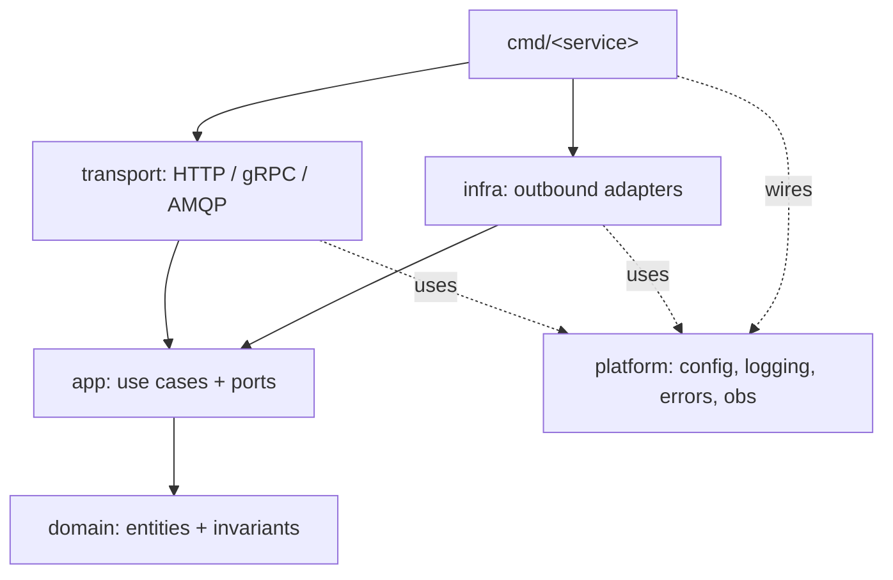
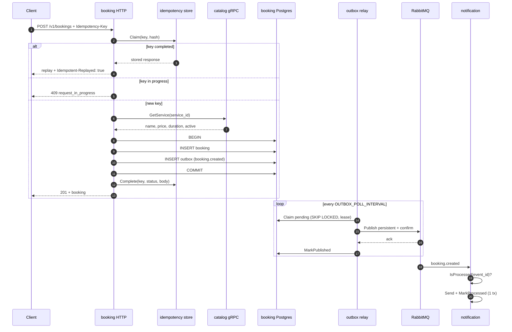
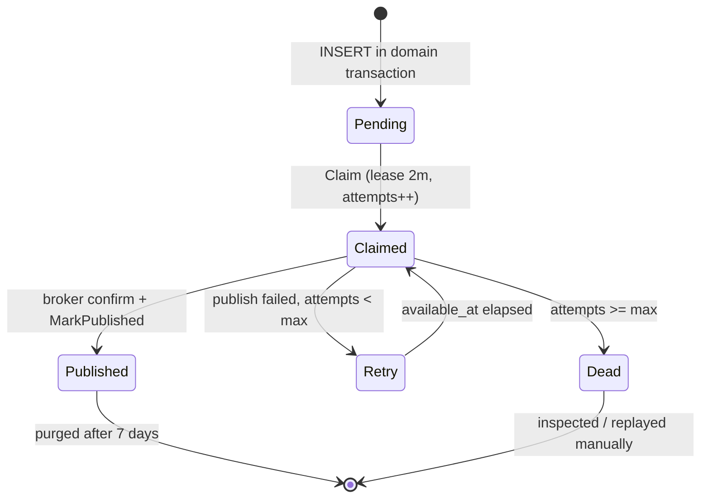
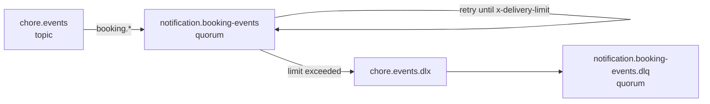
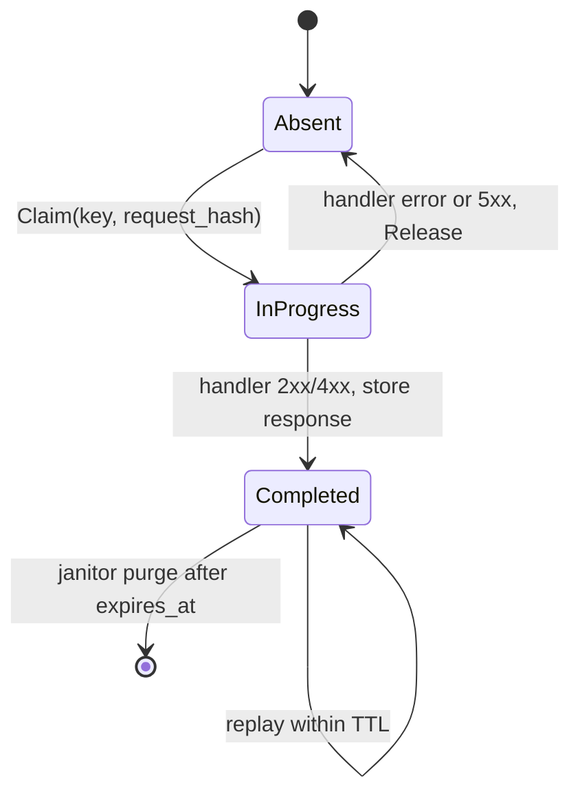

# Architecture

## 1. Context

The system lets a customer browse a catalog of household services and book one.
It is split into three deployable services with independent data ownership:



Design rules:

1. **One owner per table.** No service reads another service's schema.
2. **Synchronous only when the caller needs the answer.** Booking needs the
   catalog price before it can persist, so that call is gRPC. Notifications are
   side effects, so they are asynchronous.
3. **Business code never imports a transport.** `apperr` is the only error type
   that crosses the app boundary; each transport maps it.
4. **The database is the source of truth.** Events are derived from committed
   state, not from best-effort publish calls.

## 2. Service internals

Every service follows the same dependency direction:



- `domain` contains no framework imports. It owns validation and the booking
  status machine.
- `app` defines the use cases and the ports (interfaces) they need:
  `Repository`, `Catalog`, `Sender`, `Store`. Tests substitute fakes.
- `transport` and `infra` are adapters. `postgres`, `http`, `grpc`, `amqp` and
  `catalogclient` all live at the edge.
- `platform` holds reusable infrastructure: configuration, structured logging,
  the error model, Postgres pool, migrations, RabbitMQ, outbox relay,
  idempotency, health, tracing, metrics, admin server and process supervision.
- `cmd/<service>` is a composition root. It reads config, constructs adapters,
  registers health checks and starts the supervised group. No business logic.

## 3. Sequence: create a booking



Notes:

- The gRPC call happens **before** the transaction. Holding a database
  transaction open across a network call is a classic way to exhaust a pool.
- The booking ID is assigned by Postgres before the event is built, so the
  payload always contains the real ID. `Repository.Create` takes a
  `buildEvent func()` for exactly this reason.
- If catalog returns `NotFound`, no booking row is written. If catalog is
  unavailable, the client gets `503` and may retry safely.

## 4. Data model

### catalog

```sql
services(
  id BIGSERIAL PK,
  name TEXT, description TEXT, category TEXT,
  price_cents BIGINT, duration_minutes INT,
  active BOOLEAN, version INT,
  created_at TIMESTAMPTZ, updated_at TIMESTAMPTZ
)
-- unique lower(name) WHERE active
```

Deactivation is a soft delete. Historical bookings keep their snapshot, and the
name becomes reusable because the partial unique index only covers active rows.

### booking

```sql
bookings(
  id BIGSERIAL PK,
  service_id BIGINT, service_name TEXT,
  service_price_cents BIGINT, duration_minutes INT,
  customer_name TEXT, customer_email TEXT,
  scheduled_at TIMESTAMPTZ,
  status TEXT CHECK (pending|confirmed|completed|cancelled),
  cancellation_reason TEXT,
  version INT, created_at TIMESTAMPTZ, updated_at TIMESTAMPTZ
)

outbox_messages(
  id BIGSERIAL PK,
  event_id UUID UNIQUE,
  event_type TEXT,
  payload JSONB,
  trace_parent TEXT,
  attempts INT,
  created_at TIMESTAMPTZ,
  available_at TIMESTAMPTZ,
  claimed_at TIMESTAMPTZ,
  published_at TIMESTAMPTZ,
  failed_at TIMESTAMPTZ,
  last_error TEXT
)

idempotency_keys(
  key TEXT PK,
  request_hash TEXT,
  state TEXT CHECK (in_progress|completed),
  response_status INT,
  response_body JSONB,
  created_at TIMESTAMPTZ,
  completed_at TIMESTAMPTZ,
  expires_at TIMESTAMPTZ
)
```

Indexes are designed around the queries that run in production:

- `outbox_pending_idx (available_at, id) WHERE published_at IS NULL AND failed_at IS NULL`
  keeps the relay claim cheap as the table grows.
- `outbox_published_idx (published_at) WHERE published_at IS NOT NULL`
  supports the retention purge without scanning pending rows.
- `bookings_status_id_idx (status, id)` supports filtered keyset pagination.
- `idempotency_expires_idx (expires_at)` supports the janitor.

### notification

```sql
processed_events(event_id UUID PK, event_type TEXT, processed_at TIMESTAMPTZ)

notifications(
  id BIGSERIAL PK,
  event_id UUID, booking_id BIGINT, kind TEXT,
  recipient TEXT, subject TEXT, body TEXT,
  sent_at TIMESTAMPTZ, created_at TIMESTAMPTZ
)
```

`processed_events` is the consumer's inbox. `notifications` is an audit trail,
not a queue of pending work.

## 5. Transaction boundaries

| Operation | Transaction |
| --- | --- |
| Create booking | `INSERT bookings` + `INSERT outbox_messages` |
| Update booking | `UPDATE ... WHERE version = $n` + `INSERT outbox_messages` |
| Publish event | claim rows (`SKIP LOCKED`), publish, mark row |
| Consume event | `INSERT processed_events ... ON CONFLICT DO NOTHING` + `INSERT notifications` |
| Idempotency completion | update the key with status and response body |

The first two are the important ones: a domain change and its event are never
split across a commit.

## 6. Outbox lifecycle



- Claiming uses `FOR UPDATE SKIP LOCKED`, so horizontal relay replicas do not
  contend and a slow batch cannot block another relay.
- A lease means a crashed relay does not strand rows; they become claimable
  again when the lease expires.
- Retries use `base * 2^(attempt-1)` with ±20% jitter, capped at
  `OUTBOX_MAX_BACKOFF`.
- `MarkPublished` failure after a successful publish is logged, not retried
  inline: the next claim republishes, and consumers deduplicate.
- Published rows are purged after 7 days, hourly.

## 7. Messaging

Exchange: `chore.events`, topic, durable.
Routing key: the event type (`booking.created`, `booking.confirmed`,
`booking.completed`, `booking.cancelled`).

Consumer queue: `notification.booking-events`, quorum, bound to `booking.*`.



Consumer semantics:

- Success → `ack`.
- Transient error (database down, sender timeout) → `nack(requeue=true)`.
  RabbitMQ increments the delivery count and moves the message to the DLX when
  `x-delivery-limit` is reached.
- Permanent error (`invalid`, `not_found`, `permission_denied`) →
  `nack(requeue=false)`, straight to the DLQ.
- Handler timeout: 30s per message; prefetch 20.

## 8. Idempotency

The middleware is generic; booking is the first user.



Properties:

- Scope is the request path plus a SHA-256 of the raw body. Reusing a key with a
  different body is a client bug and returns `409`.
- A completed key replays the stored status and body, with
  `Idempotent-Replayed: true`.
- Server errors are **not** cached; the key is released so a retry can succeed.
- TTL is 24 hours. A background janitor deletes expired rows hourly.
- Without a key, the endpoint still works; it is simply not retry-safe.

## 9. Error model

`apperr.Error` carries:

- `Kind` — `invalid_argument`, `unauthenticated`, `permission_denied`,
  `not_found`, `conflict`, `unavailable`, `internal`.
- `Code` — stable machine-readable string.
- `Message` — safe for clients.
- `Details` — field-level context.
- `Cause` — logs only, never serialised.

Mapping:

| Kind | HTTP | gRPC |
| --- | --- | --- |
| invalid_argument | 400 | `InvalidArgument` |
| unauthenticated | 401 | `Unauthenticated` |
| permission_denied | 403 | `PermissionDenied` |
| not_found | 404 | `NotFound` |
| conflict | 409 | `AlreadyExists` |
| unavailable | 503 | `Unavailable` |
| internal | 500 | `Internal` |

Unknown errors become `internal_error` with a generic message. The detailed
cause is logged with `request_id` and `trace_id`, so support can correlate a
client report with the exact log line.

## 10. Observability

- **Logging**: `slog` JSON (or text in development), one access line per
  request including route, status, latency, bytes and client IP.
- **Tracing**: OTel SDK with OTLP/gRPC exporter. HTTP and gRPC are
  auto-instrumented; Postgres, outbox publish and AMQP consume are manual spans.
  The outbox stores `trace_parent` at write time, and the relay starts a
  *linked* span, so a trace shows both the original request and the later
  publish without an artificial parent-child link across time.
- **Metrics**: HTTP/gRPC RED metrics, event publish/consume counters by
  outcome, handler latency, outbox publish latency, outbox backlog count and
  oldest-pending age.
- **Probes**: `/healthz` reports process liveness; `/readyz` checks Postgres and
  RabbitMQ and returns `503` when a dependency is down. `/metrics` and
  `/version` share the admin listener.

## 11. Deployment topology

The Compose stack maps host ports for local use:

| Service | Container HTTP | Host | Admin (host) | Other |
| --- | --- | --- | --- | --- |
| catalog | 8080 | 3002 | 9092 | gRPC 50051 |
| booking | 8080 | 3001 | 9091 | |
| notification | — | — | 9093 | |
| postgres | 5432 | 5435 | | |
| rabbitmq | 5672 | 5672 | | management 15672 |
| jaeger | — | 16686 | | OTLP 4317 |
| prometheus | — | 9090 | | |

The image is multi-stage and distroless, runs as `nonroot`, and contains only
the compiled binary. Migrations are embedded, so the image is the deployment
unit; no migration sidecar or volume mount is required.
